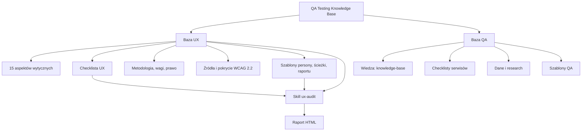

# QA Testing Knowledge Base

Baza wiedzy dla testerów stron internetowych. Ma dwie części:

- **[Baza UX](ux/README.md)**: dokładne wytyczne UX i dostępności ze źródłami, checklista, metodologia, szablony i skill dla agentów AI.
- **[Baza QA](quick-guide.md)**: podstawy testowania, checklisty dla typów serwisów, przypadki testowe i szablony.

## Mapa wiedzy



### Wytyczne UX

<!-- MAPA:START -->

**144 wytycznych** w **15 aspektach**, **239 unikalnych odnośników do źródeł**, wszystkie kryteria WCAG 2.2 A i AA pokryte, 64 punktów z testem automatycznym. Siła: BADANIE 47, WYTYCZNA 36, NORMA A 29, NORMA AA 24, PRAWO 5, NORMA AAA 3.

| Aspekt | Zakres | Punkty |
|---|---|---|
| [**HEU** Heurystyki użyteczności](ux/wytyczne/01-heurystyki.md) | system pokazuje, co się dzieje, po każdej akcji użytkownika; język i pojęcia pochodzą ze świata użytkownika; użytkownik może się wycofać z każdej akcji… | 10 |
| [**NAV** Nawigacja i architektura informacji](ux/wytyczne/02-nawigacja.md) | każda strona ma unikalny, opisowy tytuł; menu główne jest spójne na wszystkich stronach; aktualna strona jest oznaczona w nawigacji… | 10 |
| [**WIZ** Układ i hierarchia wizualna](ux/wytyczne/03-uklad-hierarchia.md) | cel strony jest zrozumiały w pierwszym widoku; na ekranie jest jedna główna akcja; rozmiar, kontrast i położenie odpowiadają ważności… | 8 |
| [**TYP** Typografia i czytelność](ux/wytyczne/04-typografia.md) | tekst główny ma co najmniej 16 px; tekst powiększa się do 200% bez utraty treści; wiersz ma 45–90 znaków, najlepiej 50–75… | 8 |
| [**KOL** Kolor i kontrast](ux/wytyczne/05-kolor-kontrast.md) | kontrast tekstu wynosi co najmniej 4,5:1; kontrast elementów interfejsu wynosi co najmniej 3:1; informacja nie jest przekazana samym kolorem… | 6 |
| [**TRE** Treść i język](ux/wytyczne/06-tresc-jezyk.md) | najważniejsza informacja jest na początku; treść jest podzielona na krótkie fragmenty; nagłówki mówią o treści… | 8 |
| [**FOR** Formularze i błędy](ux/wytyczne/07-formularze-bledy.md) | każde pole ma widoczną, trwałą etykietę; placeholder nie zastępuje etykiety; pola wymagane są oznaczone… | 15 |
| [**KLA** Klawiatura i fokus](ux/wytyczne/08-klawiatura-fokus.md) | wszystko działa z klawiatury; nie ma pułapki na klawiaturę; fokus jest widoczny… | 9 |
| [**SEM** Semantyka i czytniki ekranu](ux/wytyczne/09-semantyka-czytniki.md) | każdy obraz ma właściwy tekst alternatywny; nagłówki tworzą logiczną strukturę; strona ma regiony… | 12 |
| [**MED** Multimedia i ruch](ux/wytyczne/10-multimedia-ruch.md) | wideo ma napisy; nagrania mają alternatywę tekstową; nic nie gra samo… | 9 |
| [**KOG** Dostępność poznawcza i neuroróżnorodność](ux/wytyczne/11-poznawcza-neuroroznorodnosc.md) | nic nie przerywa zadania; wiadomo, ile kroków zostało; ekran zadania ma jeden cel… | 9 |
| [**MOB** Urządzenia mobilne i dotyk](ux/wytyczne/12-mobile-dotyk.md) | cel dotykowy ma co najmniej 24×24 px; główne cele dotykowe mają 44–48 px; można powiększać… | 9 |
| [**WYD** Wydajność](ux/wytyczne/13-wydajnosc.md) | LCP wynosi najwyżej 2,5 s; INP wynosi najwyżej 200 ms; CLS wynosi najwyżej 0,1… | 8 |
| [**ETY** Etyka, prywatność i zaufanie](ux/wytyczne/14-etyka-prywatnosc-zaufanie.md) | odrzucenie cookies jest tak samo łatwe jak zgoda; zgodę można wycofać równie łatwo, jak wyrazić; nic płatnego ani zgody nie są zaznaczone z góry… | 11 |
| [**TRA** Wyszukiwanie, produkt i transakcje](ux/wytyczne/15-transakcje-wyszukiwanie.md) | wyszukiwarka jest widoczna i prosta; wyszukiwarka rozumie literówki i synonimy; brak wyników wskazuje dalszą drogę… | 12 |

<!-- MAPA:KONIEC -->

## Jak poruszać się po bazie

| Cel | Droga |
|---|---|
| Poznać wytyczne jednego tematu | wybierz aspekt w tabeli powyżej |
| Sprawdzić stronę | [checklista UX](ux/checklista/checklista-ux.md) ([CSV](ux/checklista/checklista-ux.csv)), przy błędzie kliknij ID, aby zobaczyć źródło i poprawkę |
| Zrobić pełny audyt z personą | [procedura](ux/metodologia/procedura.md), [persona](ux/szablony/persona.md), [ścieżka](ux/szablony/sciezka.md), [raport](ux/szablony/raport.md) |
| Ustalić wagę błędu | [wagi 0–4](ux/metodologia/wagi.md) |
| Sprawdzić prawo lub WCAG | [prawo](ux/metodologia/prawo.md), [pokrycie WCAG 2.2](ux/zrodla/wcag-22.md) |
| Zweryfikować źródło | [rejestr źródeł](ux/zrodla/zrodla.md) |
| Zacząć naukę testowania | [Quick Guide](quick-guide.md), potem [proces testowania](knowledge-base/testing-process.md) |
| Testować typ serwisu | [ogólna](checklists/general-checklist.md), [sklep](checklists/e-commerce-checklist.md), [social media](checklists/social-media-checklist.md), [streaming](checklists/streaming-checklist.md), [rezerwacje](checklists/booking-checklist.md) |
| Zgłosić błąd | [szablon zgłoszenia](templates/bug-report-template.md) |

Wyszukiwanie: naciśnij `/` na stronie repozytorium i wpisz ID (np. `KOL-01`), numer WCAG (`1.4.3`) albo słowo.

Każda wytyczna ma ten sam układ: wymaganie, dlaczego, jak sprawdzić, poprawka, źródła. Oznaczenia siły i wag opisuje [README bazy UX](ux/README.md#jak-czytać-wytyczną).

## Audyt jedną komendą

[Skill ux-audit](.claude/skills/ux-audit/SKILL.md) robi z checklisty automatyczny przebieg: persona, ścieżka, zrzuty na komputerze i telefonie, testy, ocena wszystkich punktów, raport HTML z wagami i poprawkami.

1. Sklonuj repozytorium i otwórz je w Claude Code albo skopiuj `.claude/skills/ux-audit` do `~/.claude/skills/`.
2. Zainstaluj zależności (raz, Node 20+ oraz Chrome lub Edge):

   ```
   npm install --prefix .claude/skills/ux-audit/scripts
   ```

3. Wpisz komendę:

   ```
   /ux-audit https://twoja-strona.pl
   ```

Skrypty działają też bez agenta, opis w [SKILL.md](.claude/skills/ux-audit/SKILL.md). Ocenę punktów ręcznych wykonuje wtedy człowiek.

## Struktura repozytorium

```text
ux/                  baza UX
  data/              źródło prawdy: wytyczne, źródła, WCAG, COGA
  wytyczne/          15 aspektów (generowane)
  checklista/        MD, CSV, JSON (generowane)
  metodologia/       procedura, wagi, prawo
  szablony/          persona, ścieżka, raport
  zrodla/            rejestr źródeł, pokrycie WCAG (generowane)
.claude/skills/      skill ux-audit
tools/build.mjs      budowanie i kontrola bazy
knowledge-base/      podstawy testowania
checklists/          checklisty typów serwisów
templates/           szablony QA
database/ research/  dane i analiza 20 stron
reports/ sources/    raport projektu, źródła części QA
```

## Rozwijanie bazy

Edytuj `ux/data`, potem uruchom `node tools/build.mjs`. Skrypt odrzuca wytyczną bez źródła, lukę w WCAG A/AA i martwe linki. Zasady: [README bazy UX](ux/README.md#jak-dodać-lub-zmienić-wytyczną).
