# Audyt UX sklepu DICEREE

Badanie: 24 listopada 2026, https://diceree.offersupermarket.com/

Sklep ma dobrą podstawę: jasną tematykę, proste kategorie i formularz odstąpienia. Nie da się w nim jednak kupić, bo kasa jest wyłączona, a koszt dostawy nie jest nigdzie podany. Najpierw trzeba włączyć płatność, podać dostawę, naprawić linki banera i usunąć treści z szablonu.

**[Pełny raport: raport.html](raport.html)** (na GitHubie wybierz „Download raw file” i otwórz w przeglądarce). Zawiera pełną ocenę 144 punktów checklisty, źródła, plan napraw i fragmenty kodu. Ta strona jest jego skrótem.

## Wynik

| Punkty | Liczba |
|---|---|
| Spełnione | 43 |
| Błędy | 71 |
| Nie dotyczy | 9 |
| Nie sprawdzono | 21 |

| Waga problemu | Liczba |
|---|---|
| 4 krytyczny | 2 |
| 3 poważny | 12 |
| 2 drobny | 10 |
| 1 kosmetyczny | 3 |

## Persona

**Ola Wysocka, 24 lata.** Studentka grafiki, kupuje klawiaturę do nauki i grania.

> Jeśli po minucie nie wiem, ile zapłacę i kiedy przyjdzie paczka, zamykam kartę.

Ola mieszka w Krakowie i dużo kupuje przez internet. Ma dysleksję: długie bloki tekstu czyta wolno, a przy ruchu na ekranie gubi wątek. Zakup zaczyna na telefonie w tramwaju i kończy wieczorem na laptopie. To persona robocza: powstała z założeń, a nie z badań klientów sklepu.

Ola szuka klawiatury mechanicznej. Wchodzi na stronę główną, przegląda ofertę, dodaje PixelKey Pro do koszyka i próbuje zamówić. Po drodze sprawdza promocje, sprzedawcę, zwroty i regulamin.

## Problemy i poprawki

| ID | Problem | Waga | Nakład | Poprawka | Punkty |
|---|---|---|---|---|---|
| F-01 | Nie da się złożyć zamówienia | 4 krytyczny | do 1 dnia | Włącz bramkę płatności (Orders > Payment Gateways). Do tego czasu ukryj Checkout i Add to Cart, a w zamian pokaż: „Sprzedaż startuje wkrótce. Napisz do nas, jeśli chcesz kupić”. | HEU-05, HEU-09 |
| F-02 | Koszt i termin dostawy nie są nigdzie podane | 4 krytyczny | do 1 dnia | Dodaj pod ceną linię „Dostawa od … zł, … dni roboczych, zwrot 14 dni” i tę samą kwotę w szufladzie i koszyku. Dodaj stronę „Dostawa i zwroty” w menu. | TRA-08, KOG-07 |
| F-04 | Przyciski banera i linki stopki prowadzą w złe miejsce | 3 poważny | do 1 h | Ustaw adresy kategorii: Klawiatury, Monitory, All Products. Usuń „Shop Chairs” i krzesła z tekstu. W regulaminie wpisz /page/privacy-policy, w stopce usuń linki zastępcze. | NAV-08, TRE-06 |
| F-08 | Nie wiadomo, kto sprzedaje | 3 poważny | do 1 h | Podaj imię i nazwisko lub firmę, adres, e-mail w domenie sklepu i telefon, a przy działalności także NIP. Te same dane w kontakcie, regulaminie i polityce. Treść stron prawnych sprawdź z prawnikiem. | ETY-09 |
| F-10 | Formularz kontaktowy nie ma etykiet | 3 poważny | do 1 h | Dodaj widoczne etykiety, słowo „wymagane” lub „opcjonalnie” oraz autocomplete i type. | FOR-01, FOR-02, FOR-03, FOR-06 |
| F-14 | Ikony na telefonie nie mają nazw i podpisów | 3 poważny | do 1 h | Zostaw krótkie podpisy na telefonie albo dodaj aria-label. Liczbę w koszyku wpisz do nazwy. | SEM-05, NAV-07, SEM-06, KOG-06 |
| F-03 | Szuflada koszyka jest pusta, choć produkt jest w koszyku | 3 poważny | do 1 dnia | Wczytuj koszyk przy każdym otwarciu szuflady. Dla naprawdę pustego koszyka pokaż „Koszyk jest pusty” i przycisk „Zobacz produkty”. | HEU-01, TRA-04 |
| F-05 | Strona 404 jest reklamą platformy i odcina od sklepu | 3 poważny | do 1 dnia | Najpierw napraw link. Potem ustaw własną stronę 404 w panelu, a jeśli platforma na to nie pozwala, zgłoś to Freewebstore. Treść: „Nie ma takiej strony”, link do produktów i wyszukiwarka. | NAV-10, TYP-02, MOB-03, TYP-06 |
| F-06 | Wyszukiwarka nie zna polskich słów i kończy ślepo | 3 poważny | do 1 dnia | Dopisz polskie słowa do nazw, opisów lub tagów produktów. Na ekranie bez wyników pokaż kategorie i link „Wszystkie produkty”. Na komputerze pokaż pole zamiast samej lupy. | TRA-01, TRA-02, TRA-03 |
| F-07 | Treści demonstracyjne i zastępcze w działającym sklepie | 3 poważny | do 1 dnia | Usuń lub ukryj produkty demo i lorem ipsum. Popraw „%%” na „%”. Na stronie głównej i w Offers pokaż własne klawiatury, myszki i monitory. | HEU-08, TRE-03 |
| F-09 | Strona produktu nie odpowiada na pytania kupującego | 3 poważny | do 1 dnia | Ułóż na telefonie: zdjęcie, nazwa, cena, warianty, Add to Cart, dostawa i zwrot, opis, udostępnianie. Cechy zapisz listą. Zmieniaj opis przełączników razem z wariantem i dodaj 3–4 zdjęcia. | TRA-06, TRE-02, WIZ-03 |
| F-11 | Karuzela rusza się sama i nie ma pauzy | 3 poważny | do 1 dnia | Najprościej: jeden stały baner z jednym przyciskiem. Jeśli karuzela zostaje, wyłącz autoplay, zamień kropki na przyciski i wyłącz z fokusu ukryte slajdy. | MED-04, MED-05, KLA-01, KLA-05, SEM-04 |
| F-12 | Szuflada i menu nie działają dobrze z klawiaturą | 3 poważny | do 1 dnia | Użyj elementu dialog z showModal(): przejmie fokus i zablokuje tło. Po zamknięciu zwróć fokus na ikonę. Podmenu zrób jako button z aria-expanded. | KLA-07, SEM-08 |
| F-13 | Za słaby kontrast tekstu, pól i banera | 3 poważny | do 1 dnia | Połóż pod tekst banera jasną lub ciemną płaszczyznę. Stare ceny #595959, aktywna kategoria ciemnozielona z podkreśleniem, ramki #767676, logo w ciemnej wersji. | KOL-01, KOL-02, KOL-03, KOL-04 |
| F-18 | Instrukcja zwrotu omija własny formularz | 2 drobny | do 1 h | Dodaj w regulaminie link do formularza i listę kroków: 1. wypełnij formularz, 2. spakuj produkt, 3. wyślij na adres, 4. odbierz zwrot pieniędzy. | KOG-08, TRE-08 |
| F-19 | Tytuły i nagłówki nie mówią, gdzie jestem | 2 drobny | do 1 h | Wzór tytułu: „Klawiatury mechaniczne | DICEREE”, „Wyniki: klawiatura | DICEREE”. Jeden h1 na stronę, potem h2 i h3. | NAV-01, SEM-02 |
| F-20 | Brak linku do treści, oznaczenia strony i fokusu ilości | 2 drobny | do 1 h | Dodaj link „Przejdź do treści”, aria-current w menu i widoczny outline. | KLA-06, NAV-03, KLA-03 |
| F-22 | Za małe cele dotykowe | 2 drobny | do 1 h | Ustaw minimum 44×44 px. | MOB-01, MOB-02 |
| F-23 | Karty produktów na telefonie są ucięte | 2 drobny | do 1 h | Ustaw jedną kolumnę także w Offers, odstęp między cenami i karty bez stałej wysokości. | WIZ-04, TYP-05 |
| F-15 | Dwa języki na jednej stronie | 2 drobny | do 1 dnia | Wybierz jeden język. Przy sprzedaży w złotych najprościej: polski interfejs i lang="pl". Popraw „Prezycja” na „Precyzja”. | HEU-02, TRE-07 |
| F-16 | Koszyk i odstąpienie wyglądają jak z innego sklepu | 2 drobny | do 1 dnia | Ustaw ten sam szablon nagłówka, font i przyciski. Zielony zostaw dla głównej akcji, szary dla drugorzędnej. Wszędzie pisz „zł”. | HEU-04, WIZ-07, NAV-02, KOL-06 |
| F-17 | Regulamin i polityka są trudne do czytania | 2 drobny | do 1 dnia | Zawijaj długie adresy, ogranicz szerokość tekstu, dodaj spis treści i skrót „W skrócie” na początku. Przygotuj polską wersję. | WIZ-06, SEM-10, KOG-09, TYP-03, TRE-04 |
| F-21 | Regiony strony są niepełne | 2 drobny | do 1 dnia | Użyj footer dla stopki i main w szablonie koszyka. | SEM-03 |
| F-24 | Wolniejsze ładowanie i przesuwanie układu | 2 drobny | do 1 dnia | Dodaj width i height, srcset oraz fetchpriority="high" dla banera. W fontach ustaw font-display: swap. Część tych plików należy do Freewebstore. | WYD-01, WYD-03, WYD-05, WYD-06 |
| F-25 | Nowa karta bez zapowiedzi | 1 kosmetyczny | do 1 h | Usuń target="_blank" albo dopisz „otwiera nową kartę” w nazwie. Zostaw 2–3 ikony. | NAV-09 |
| F-26 | Drobny tekst i wersaliki | 1 kosmetyczny | do 1 h | Tekst treści 16 px, dopiski co najmniej 14 px, bez text-transform w nagłówkach. | TYP-01, TYP-07 |
| F-27 | Nieudane żądania w konsoli | 1 kosmetyczny | do 1 h | Otwórz zakładkę Network z filtrem „status-code:400” i usuń lub napraw wskazane zasoby. | WYD-08 |

## Co działa dobrze

- Formularz odstąpienia ma widoczne etykiety i oznaczone pola opcjonalne
- Po dodaniu produktu szuflada od razu pokazuje nazwę, wariant i cenę
- Warianty produktu mają poprawne role i stan zaznaczenia
- Menu, okruszki i mapa strony dają kilka dróg do tej samej treści
- Wyszukiwarka znosi literówki w nazwie („pixlkey”) i zna kody produktów
- Główne strony mieszczą się w 320 px, fokus jest prawie wszędzie widoczny, Escape zamyka szufladę
- Całość po HTTPS, szybka odpowiedź serwera (do 485 ms), bez wyskakujących okien

## Ścieżka persony

### 1. Strona główna

Cel: Zrozumieć, co to za sklep i czy są w nim klawiatury. Nastrój: neutralnie.

> Sprzęt dla graczy, dobrze. Tylko czemu logo tak słabo widać?

Tematyka jest zrozumiała, ale tekst banera ginie na zdjęciu, a na telefonie slajdy zmieniają się same. Wśród polecanych są produkty niezwiązane z graniem.

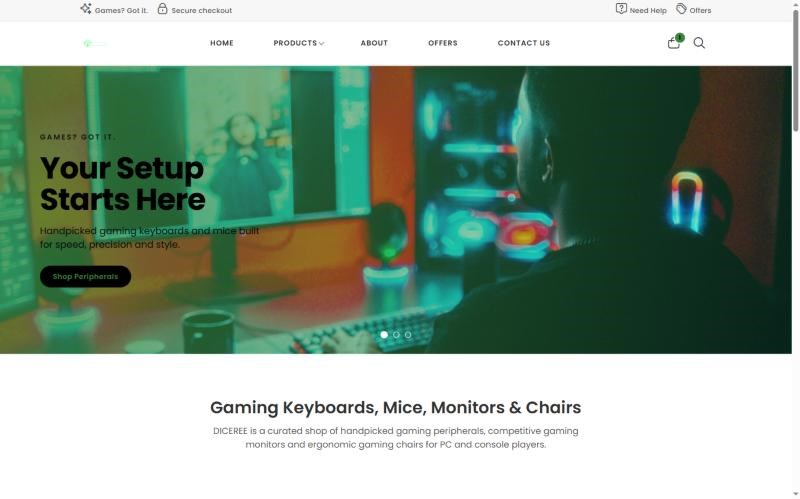 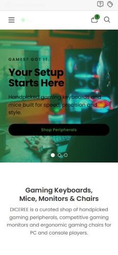

### 2. Przycisk „Shop Peripherals” w banerze

Cel: Przejść z banera prosto do klawiatur i myszek. Nastrój: źle.

> Kliknęłam i nic. To ta sama strona?

„Shop Peripherals” ładuje ponownie stronę główną. Nie ma żadnej informacji, co się stało.

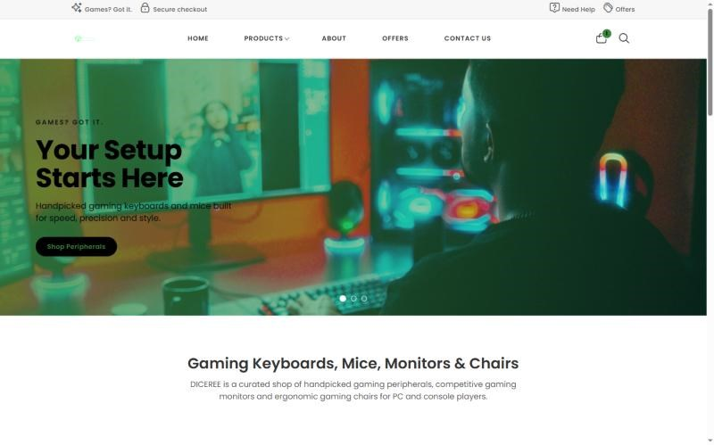 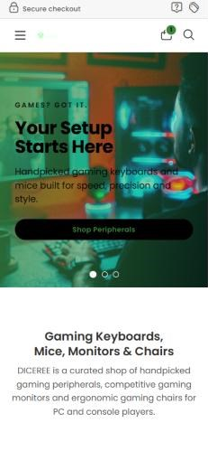

### 3. Przycisk „Shop the collection”

Cel: Obejrzeć całą kolekcję. Nastrój: bardzo źle.

> To już nie jest ten sklep. Co ja kliknęłam?

„Shop the collection” kończy się na 404 z reklamą Freewebstore. Do sklepu wraca się tylko przyciskiem Wstecz.

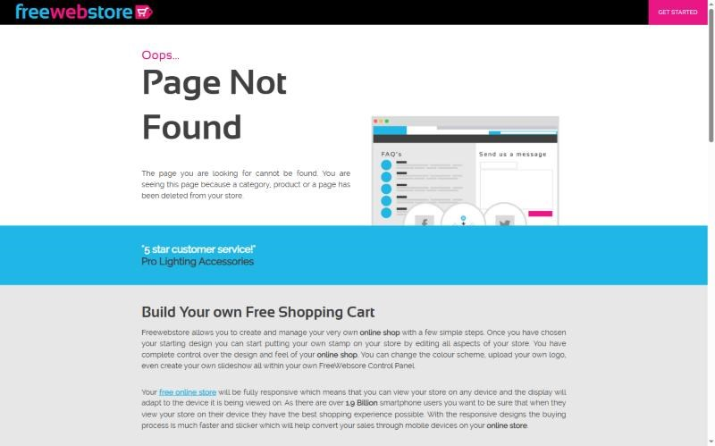 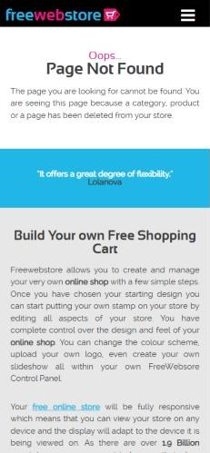

### 4. Menu Products

Cel: Znaleźć kategorię z klawiaturami. Nastrój: neutralnie.

> Są Klawiatury Mechaniczne. A reszta po angielsku?

Menu działa także klawiaturą. Miesza języki, a przełącznik podmenu ma 14×3 px.

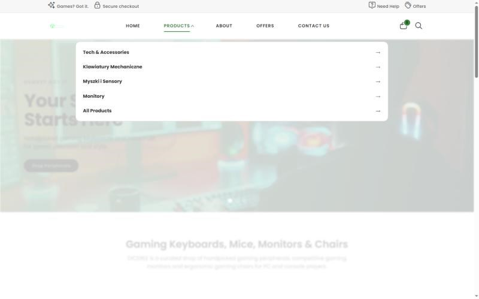 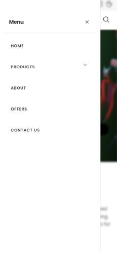

### 5. Lista wszystkich produktów

Cel: Sprawdzić, co sklep ma w ofercie. Nastrój: neutralnie.

> Hub USB? Szukam klawiatury. I to chyba przykład z szablonu.

Lista jest czytelna, w jednej kolumnie na telefonie. Część produktów to treść demonstracyjna.

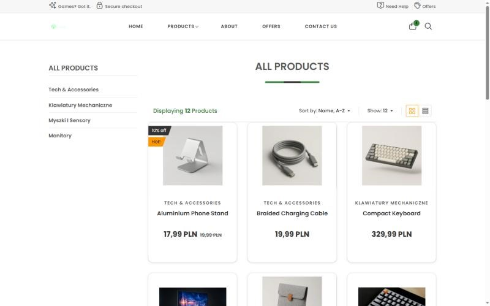 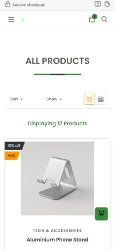

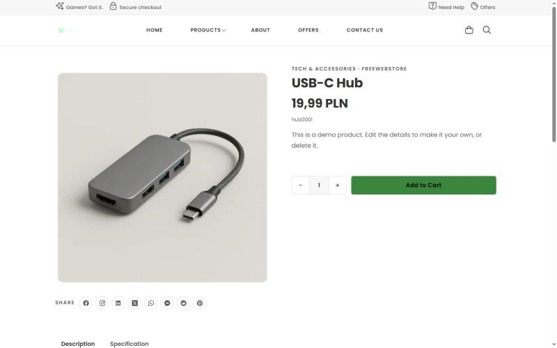

### 6. Kategoria Klawiatury Mechaniczne

Cel: Porównać klawiatury. Nastrój: dobrze.

> Dwie klawiatury, ceny widać. Biorę PixelKey.

Kategoria szybko prowadzi do produktu. Aktywna kategoria jest jasnopomarańczowa i słabo widoczna.

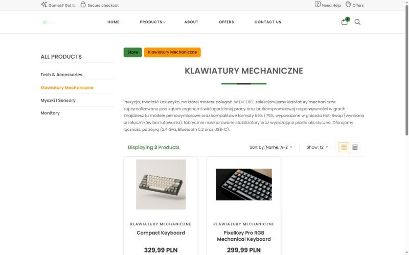 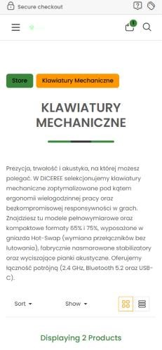

### 7. Strona produktu PixelKey Pro

Cel: Sprawdzić cenę, przełączniki, dostawę i zwrot. Nastrój: neutralnie.

> Fajna, ale ile za dostawę? I czy to Brown czy Red?

Warianty są dobrze zrobione. Opis jest jednym blokiem i nie zgadza się z wybranym wariantem, brak dostawy i zwrotu.

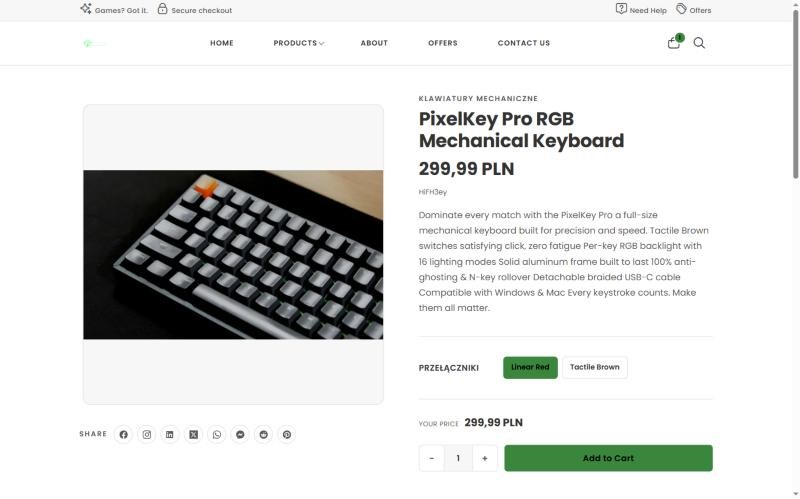 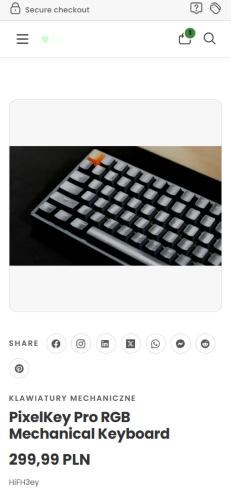

### 8. Dodanie do koszyka

Cel: Upewnić się, że klawiatura jest w koszyku. Nastrój: źle.

> Przed chwilą była w koszyku, a teraz pusto?

Po dodaniu szuflada potwierdza produkt. Po przejściu dalej i otwarciu z nagłówka jest pusta.

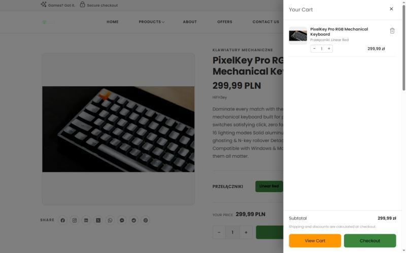 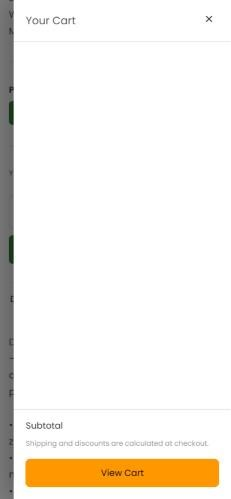

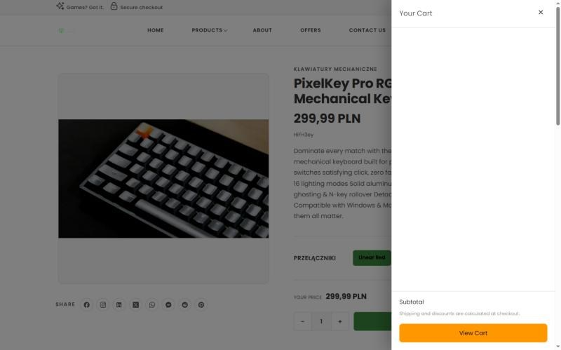

### 9. Koszyk i przejście do kasy

Cel: Poznać pełny koszt i zamówić. Nastrój: bardzo źle.

> Jestem właścicielem sklepu? Nie, ja chcę tylko zapłacić.

Koszyk wygląda inaczej niż sklep. Przycisk CHECKOUT jest wyłączony, a komunikat jest dla właściciela.

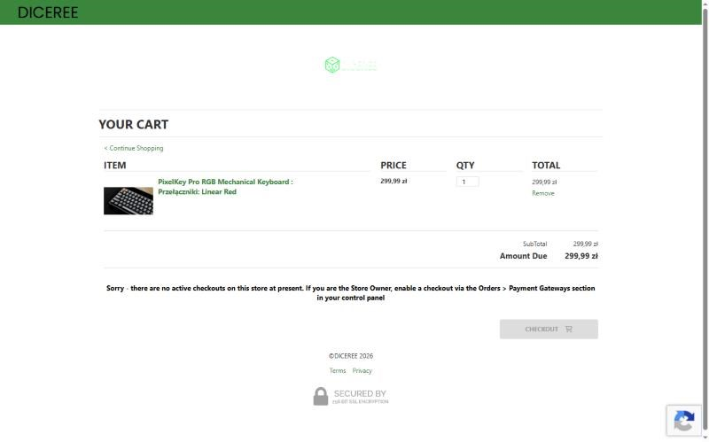 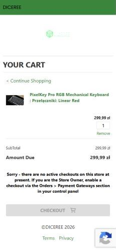

### 10. Wyszukiwarka: „klawiatura”

Cel: Znaleźć klawiaturę po polsku. Nastrój: bardzo źle.

> Przecież przed chwilą widziałam klawiatury.

Wyszukiwanie po polsku nic nie znajduje i nie podpowiada, co dalej.

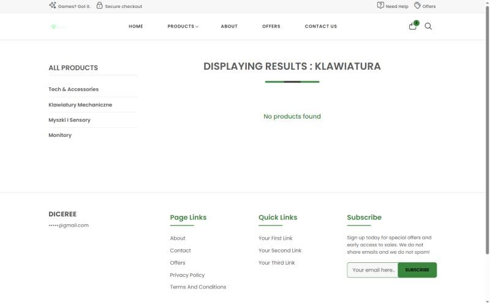 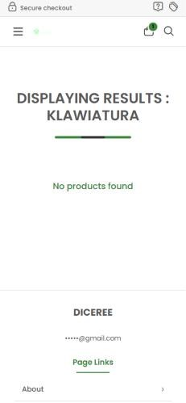

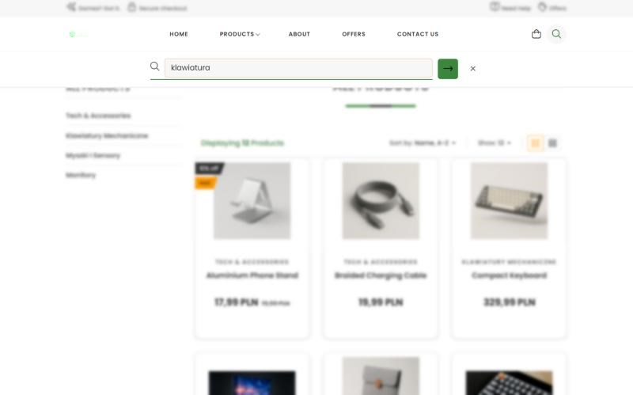

### 11. Oferty

Cel: Sprawdzić promocje. Nastrój: neutralnie.

> Są przeceny, ale słuchawki i podstawka to nie to.

Stare i nowe ceny są pokazane. Na telefonie dwie kolumny ściskają ceny.

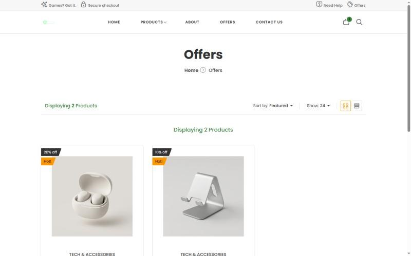 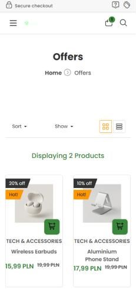

### 12. Produkt z promocji: Wireless Earbuds

Cel: Obejrzeć przecenione słuchawki. Nastrój: źle.

> To chyba nie jest prawdziwy produkt.

Produkt z szablonu ma cenę i przycisk zakupu. Przy ładowaniu układ się przesuwa.

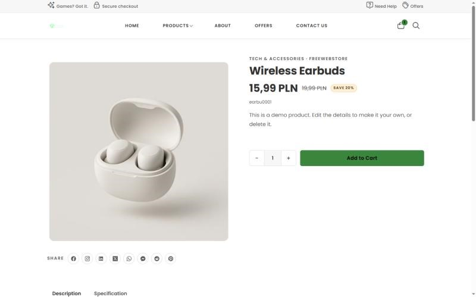 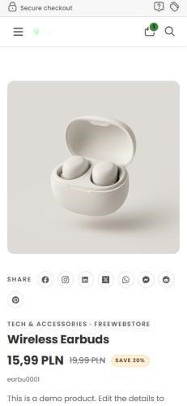

### 13. O nas

Cel: Sprawdzić, kto prowadzi sklep. Nastrój: neutralnie.

> Krótko i na temat. Ale kto to prowadzi?

Strona opisuje sklep, ale nie podaje sprzedawcy. Wiersze są długie.

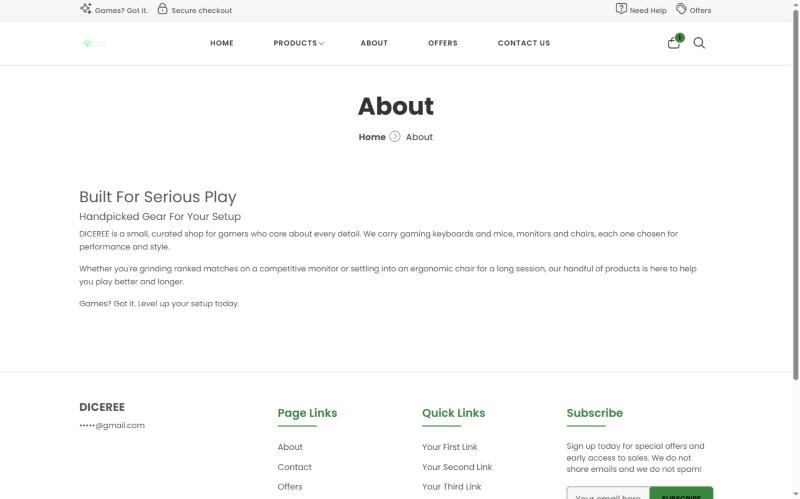 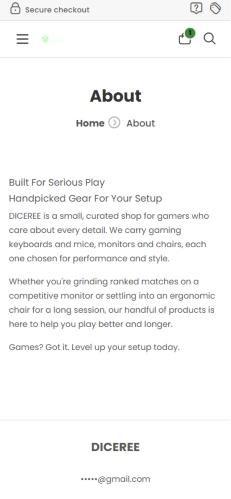

### 14. Kontakt

Cel: Zapytać o dostawę. Nastrój: bardzo źle.

> Example Street? Telefon z samych zer?

Dane kontaktowe są z szablonu. Pola mają tylko placeholdery, a reCAPTCHA zasłania róg ekranu.

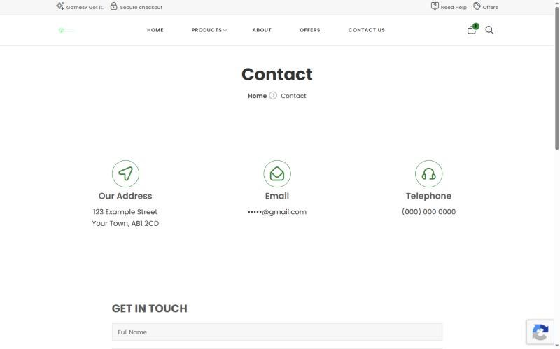 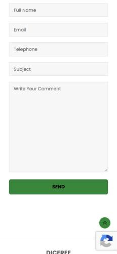

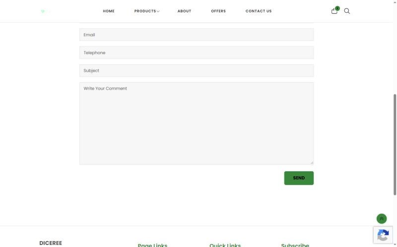

### 15. Odstąpienie od umowy

Cel: Sprawdzić, jak zwrócić towar. Nastrój: dobrze.

> O, to jest proste. Pięć pól i przycisk.

Najlepszy formularz w sklepie: widoczne etykiety i oznaczone pola opcjonalne. Wyróżnia się innym fontem i czarnym przyciskiem.

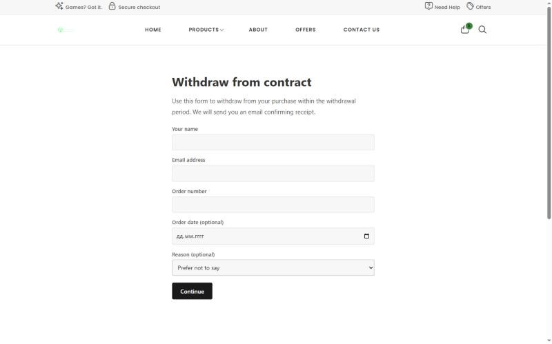 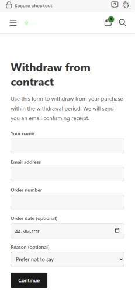

### 16. Polityka prywatności

Cel: Sprawdzić, co dzieje się z danymi. Nastrój: źle.

> Muszę przesuwać w bok i dalej nie rozumiem.

Tabela rozpycha stronę na telefonie. Tekst kończy się lorem ipsum.

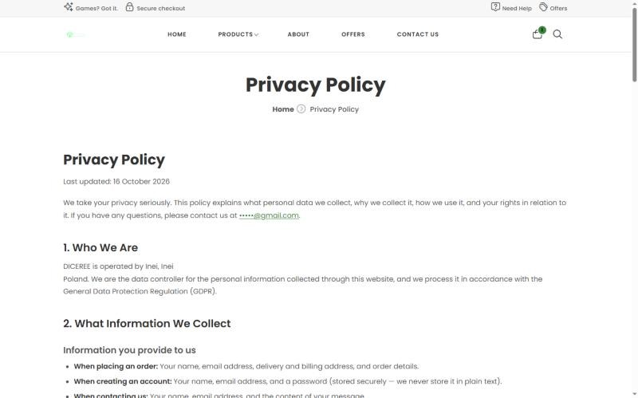 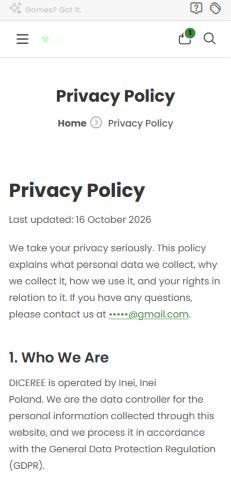

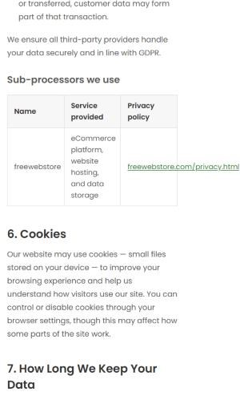

### 17. Regulamin

Cel: Znaleźć koszt i czas dostawy. Nastrój: źle.

> Zwrot w 14 dni, dobrze. Ale dostawy dalej nie ma.

Prawo odstąpienia jest opisane, ale każe pisać e-mail zamiast użyć formularza. Link do polityki prowadzi do 404.

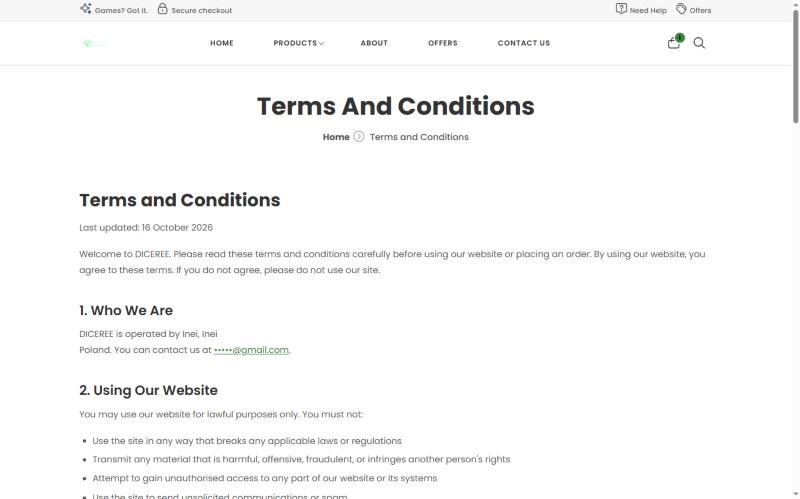 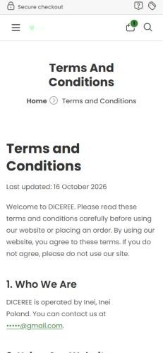

### 18. Mapa strony

Cel: Znaleźć stronę, do której nie trafiła z menu. Nastrój: neutralnie.

> Tu w końcu widać wszystko.

Mapa strony pokazuje wszystkie strony. Nie ma nagłówka głównego.

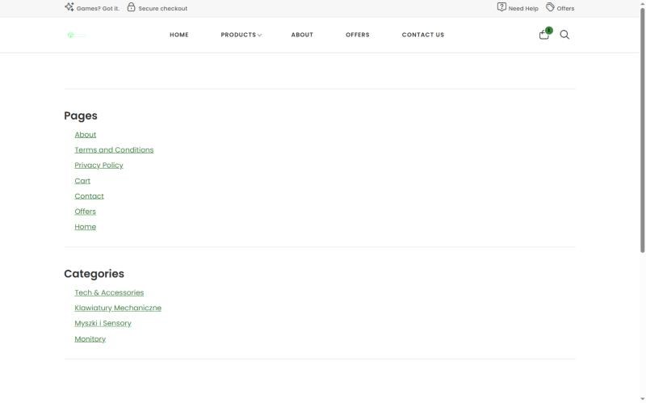 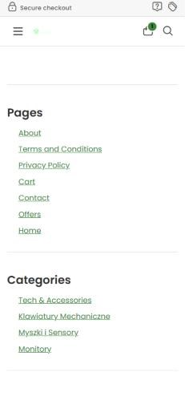

## Ograniczenia

Cloudflare odrzuca automatyczną przeglądarkę, więc audyt przeprowadzono w przeglądarce wbudowanej w aplikację Claude. Nie omijano tego zabezpieczenia. Ekrany telefonu i komputera są emulowane, a zrzuty to ich podglądy pomniejszone do 800 px. Adres e-mail na zrzutach zamaskowano. Nie wysyłano formularzy i nic nie kupiono, dlatego błędy walidacji, kasa i potwierdzenie nie są ocenione. Nie używano czytnika ekranu ani fizycznego telefonu. Czasy to pomiary z jednego komputera. Uwagi o danych sprzedawcy i dostępności nie są poradą prawną.

- Kasa, płatność i potwierdzenie zamówienia: sklep nie ma włączonej płatności
- Wysłanie formularzy (kontakt, odstąpienie, newsletter): formularzy nie wysyłano
- Konto klienta i logowanie: nie znaleziono linku do konta
- Czytnik ekranu i fizyczny telefon: sprawdzono kod i emulowany ekran
