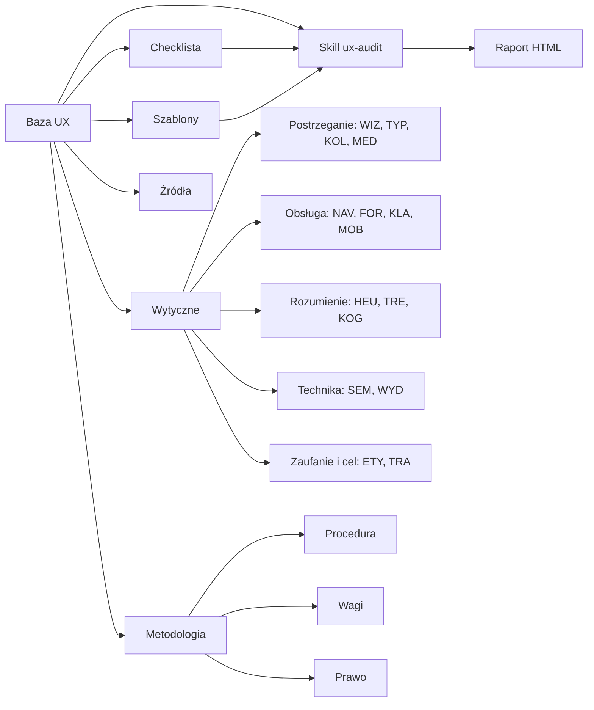

# Baza wiedzy UX stron internetowych

[← Strona główna repozytorium](../README.md)

Dokładne wytyczne UX i dostępności z progami, sposobem sprawdzenia, poprawką i źródłem.

## Mapa wiedzy

<!-- MAPA:START -->

**144 wytycznych** w **15 aspektach**, **239 unikalnych odnośników do źródeł**, wszystkie kryteria WCAG 2.2 A i AA pokryte, 64 punktów z testem automatycznym. Siła: BADANIE 47, WYTYCZNA 36, NORMA A 29, NORMA AA 24, PRAWO 5, NORMA AAA 3.

| Aspekt | Zakres | Punkty |
|---|---|---|
| [**HEU** Heurystyki użyteczności](wytyczne/01-heurystyki.md) | system pokazuje, co się dzieje, po każdej akcji użytkownika; język i pojęcia pochodzą ze świata użytkownika; użytkownik może się wycofać z każdej akcji… | 10 |
| [**NAV** Nawigacja i architektura informacji](wytyczne/02-nawigacja.md) | każda strona ma unikalny, opisowy tytuł; menu główne jest spójne na wszystkich stronach; aktualna strona jest oznaczona w nawigacji… | 10 |
| [**WIZ** Układ i hierarchia wizualna](wytyczne/03-uklad-hierarchia.md) | cel strony jest zrozumiały w pierwszym widoku; na ekranie jest jedna główna akcja; rozmiar, kontrast i położenie odpowiadają ważności… | 8 |
| [**TYP** Typografia i czytelność](wytyczne/04-typografia.md) | tekst główny ma co najmniej 16 px; tekst powiększa się do 200% bez utraty treści; wiersz ma 45–90 znaków, najlepiej 50–75… | 8 |
| [**KOL** Kolor i kontrast](wytyczne/05-kolor-kontrast.md) | kontrast tekstu wynosi co najmniej 4,5:1; kontrast elementów interfejsu wynosi co najmniej 3:1; informacja nie jest przekazana samym kolorem… | 6 |
| [**TRE** Treść i język](wytyczne/06-tresc-jezyk.md) | najważniejsza informacja jest na początku; treść jest podzielona na krótkie fragmenty; nagłówki mówią o treści… | 8 |
| [**FOR** Formularze i błędy](wytyczne/07-formularze-bledy.md) | każde pole ma widoczną, trwałą etykietę; placeholder nie zastępuje etykiety; pola wymagane są oznaczone… | 15 |
| [**KLA** Klawiatura i fokus](wytyczne/08-klawiatura-fokus.md) | wszystko działa z klawiatury; nie ma pułapki na klawiaturę; fokus jest widoczny… | 9 |
| [**SEM** Semantyka i czytniki ekranu](wytyczne/09-semantyka-czytniki.md) | każdy obraz ma właściwy tekst alternatywny; nagłówki tworzą logiczną strukturę; strona ma regiony… | 12 |
| [**MED** Multimedia i ruch](wytyczne/10-multimedia-ruch.md) | wideo ma napisy; nagrania mają alternatywę tekstową; nic nie gra samo… | 9 |
| [**KOG** Dostępność poznawcza i neuroróżnorodność](wytyczne/11-poznawcza-neuroroznorodnosc.md) | nic nie przerywa zadania; wiadomo, ile kroków zostało; ekran zadania ma jeden cel… | 9 |
| [**MOB** Urządzenia mobilne i dotyk](wytyczne/12-mobile-dotyk.md) | cel dotykowy ma co najmniej 24×24 px; główne cele dotykowe mają 44–48 px; można powiększać… | 9 |
| [**WYD** Wydajność](wytyczne/13-wydajnosc.md) | LCP wynosi najwyżej 2,5 s; INP wynosi najwyżej 200 ms; CLS wynosi najwyżej 0,1… | 8 |
| [**ETY** Etyka, prywatność i zaufanie](wytyczne/14-etyka-prywatnosc-zaufanie.md) | odrzucenie cookies jest tak samo łatwe jak zgoda; zgodę można wycofać równie łatwo, jak wyrazić; nic płatnego ani zgody nie są zaznaczone z góry… | 11 |
| [**TRA** Wyszukiwanie, produkt i transakcje](wytyczne/15-transakcje-wyszukiwanie.md) | wyszukiwarka jest widoczna i prosta; wyszukiwarka rozumie literówki i synonimy; brak wyników wskazuje dalszą drogę… | 12 |

<!-- MAPA:KONIEC -->

## Jak poruszać się po bazie

| Chcę… | Otwórz |
|---|---|
| zrozumieć jeden temat | aspekt w tabeli powyżej |
| sprawdzić stronę punkt po punkcie | [checklista](checklista/checklista-ux.md) lub [CSV do arkusza](checklista/checklista-ux.csv) |
| wiedzieć, jak przeprowadzić audyt | [procedura](metodologia/procedura.md) |
| ustalić wagę błędu | [wagi](metodologia/wagi.md) |
| sprawdzić, co wymaga prawo | [prawo](metodologia/prawo.md) |
| znaleźć wytyczną do kryterium WCAG | [pokrycie WCAG 2.2](zrodla/wcag-22.md) |
| zobaczyć, skąd pochodzi zalecenie | [rejestr źródeł](zrodla/zrodla.md) |
| opisać personę i ścieżkę | [szablon persony](szablony/persona.md), [szablon ścieżki](szablony/sciezka.md) |
| napisać raport | [szablon raportu](szablony/raport.md) |
| zlecić audyt agentowi AI | [skill ux-audit](../.claude/skills/ux-audit/SKILL.md) |

## Jak czytać wytyczną

- **ID**, np. `KOL-01`: trzy litery aspektu i numer. Tego samego ID używają checklista, raport i skill.
- **Siła** wynika z pierwszego źródła:

| Oznaczenie | Znaczenie |
|---|---|
| NORMA A / AA / AAA | kryterium WCAG 2.2 danego poziomu |
| PRAWO | akt prawny UE lub polski |
| WYTYCZNA | oficjalne zalecenie organizacji, platformy lub systemu projektowego |
| BADANIE | wynik badań lub opracowanie ekspertów UX |

- **Waga** 0–4 to domyślna ważność naruszenia, do korekty w kontekście.
- **Sprawdzanie**: automat, ręcznie albo na ścieżce persony.

## Jak dodać lub zmienić wytyczną

1. Edytuj dane w [`data`](data/), nie pliki Markdown.
2. Dodaj źródło do `data/sources.mjs`, po otwarciu strony i sprawdzeniu treści. `W:1.4.3` oznacza kryterium WCAG, `C:4.6.1` wzorzec COGA.
3. Uruchom `node tools/build.mjs`. Skrypt zbuduje aspekty, checklistę, źródła i dane skilla oraz odrzuci wytyczną bez źródła, nieznane kryterium, lukę w WCAG A/AA i martwe linki.

## Ograniczenia

Baza nie zastępuje badań z użytkownikami, pełnej oceny WCAG-EM ani porady prawnej. Liczby z badań obowiązują dla ich próby i daty.
